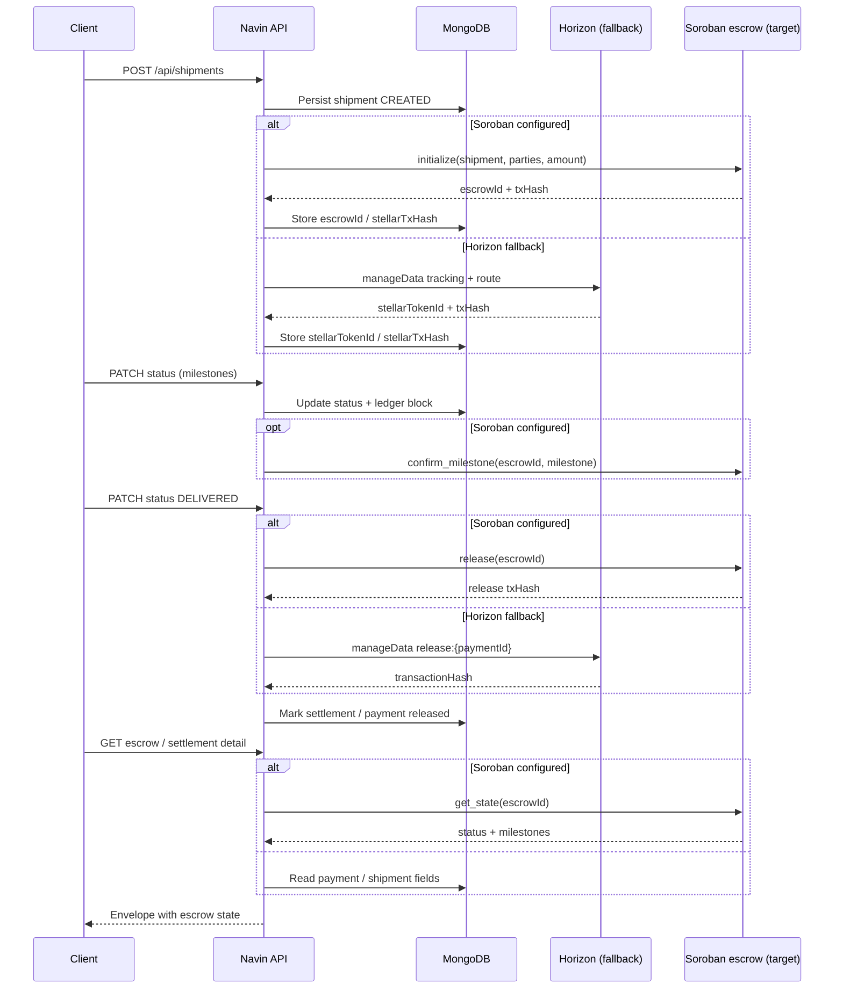

# Blockchain & escrow integration

This document describes how Navin Backend uses Stellar today (Horizon +
`manageData` emulation) and the roadmap to a real **Soroban escrow contract**
expected by the frontend.

Related issues:

- [#360](https://github.com/Navin-xmr/navin-backend/issues/360) — Soroban escrow contract integration
- [#361](https://github.com/Navin-xmr/navin-backend/issues/361) — On-chain event indexer for settlements / milestones
- [#363](https://github.com/Navin-xmr/navin-backend/issues/363) — Dynamic Stellar / explorer URLs

---

## Current state (Horizon-only fallback)

All on-chain writes go through the Stellar **Horizon** HTTP API via
`@stellar/stellar-sdk` in `src/services/stellar.service.ts`. There is **no**
Soroban RPC client and **no** deployed escrow contract ID in the runtime path
today (env placeholders exist; see below).

| Operation         | Function              | Mechanism                                                                           | When                                  |
| ----------------- | --------------------- | ----------------------------------------------------------------------------------- | ------------------------------------- |
| Tokenize shipment | `tokenizeShipment`    | Horizon `Operation.manageData` for `tracking:{shipmentId}` and `route:{shipmentId}` | Shipment create                       |
| Anchor telemetry  | `anchorTelemetryHash` | Horizon `manageData` + `Memo.hash`                                                  | Stellar worker after telemetry ingest |
| Release escrow    | `releaseEscrow`       | Horizon `manageData` `release:{paymentId}` + memo `escrow-release:…`                | Shipment reaches `DELIVERED`          |

Config / network:

- `STELLAR_SECRET_KEY` — signing key for the backend account
- `STELLAR_NETWORK` — `testnet` | `public` (selects Horizon network passphrase)
- Horizon server is currently hard-coded to `https://horizon-testnet.stellar.org` in code
- Explorer links: `getStellarExplorerUrl(txHash)` → stellar.expert

### Error Handling Note

In `src/services/stellar.service.ts:157–160`, `releaseEscrow` catches any submission or network errors and swallows them, returning `{ success: false }` instead of throwing an `AppError`. Callers handle unfulfilled settlements via payment retry status.

### Event Indexing & Confirmation Tracking

A background BullMQ worker (`src/workers/stellar-indexer.worker.ts`) runs on a 30-second interval (`STELLAR_INDEXER_JOB`). It calls `indexStellarTransactions`, tracks transaction confirmation counts, and verifies anchored telemetry and released settlements after three ledgers; simulated-chain confirmations are immediate.

### Why this is a fallback

`manageData` entries prove that the backend account recorded an event; they do
**not**:

- Hold or transfer payment value in escrow
- Enforce multi-party confirmations on milestones
- Expose a queryable on-contract state machine the frontend can poll

Escrow “release” today is an audit write, not a fund disbursement.

---

## Gap to Soroban

| Capability              | Horizon fallback                              | Soroban target                                                                         |
| ----------------------- | --------------------------------------------- | -------------------------------------------------------------------------------------- |
| Escrow funding / hold   | None                                          | Contract holds / tracks escrowed amount                                                |
| Milestone confirmation  | Off-chain status + optional ledger block      | `confirm_milestone` on-contract                                                        |
| Release on delivery     | `manageData` release marker                   | `release` moves funds / finalizes state                                                |
| Read escrow state       | DB + payment documents                        | `get_state` via Soroban RPC                                                            |
| Event indexing          | Polling indexer (`stellar-indexer.worker.ts`) | On-chain event indexer ([#361](https://github.com/Navin-xmr/navin-backend/issues/361)) |
| Network / explorer URLs | Partially hard-coded                          | Dynamic URLs ([#363](https://github.com/Navin-xmr/navin-backend/issues/363))           |

Until Soroban lands, keep Horizon paths as the **default fallback** so create /
delivery flows continue to work without `SOROBAN_RPC_URL` or `ESCROW_CONTRACT_ID`.

---

## Target Interface & Migration Plan

The target Soroban escrow contract method definitions and TypeScript interfaces are specified in [docs/chain-interface.md](file:///home/izk/Documents/DRIPS/navin-backend/docs/chain-interface.md) (marked **DRAFT v0**).

### Migration Plan (ChainAdapter Port Architecture)

Instead of temporary config-presence flags spread across services, the integration moves behind a unified `ChainAdapter` port:

1. **Interface Freeze**: Formalize `ChainAdapter` port interface in `docs/chain-interface.md`.
2. **Implement `SimulatedAdapter`**: Package existing Horizon `manageData` logic into `SimulatedAdapter` implementing `ChainAdapter`.
3. **Implement `SorobanAdapter`**: Build `SorobanAdapter` using Soroban RPC client (`SOROBAN_RPC_URL`) and smart contract (`ESCROW_CONTRACT_ID`).
4. **Adapter Factory**: Instantiate the appropriate `ChainAdapter` dynamically via factory configuration.
5. **Persist Contract Identifiers**: Persist `escrowId` / transaction hashes on payment and shipment documents.
6. **Indexer Integration**: Extend `stellar-indexer.worker.ts` to index Soroban contract events into settlements and ledger modules.

---

## Environment variables

| Variable                 | Required for              | Description                           |
| ------------------------ | ------------------------- | ------------------------------------- |
| `STELLAR_SECRET_KEY`     | Horizon + Soroban signing | Backend account secret                |
| `STELLAR_NETWORK`        | Both                      | `testnet` or `public`                 |
| `SOROBAN_RPC_URL`        | Soroban only              | Soroban JSON-RPC endpoint             |
| `ESCROW_CONTRACT_ID`     | Soroban only              | Deployed escrow contract ID (`C…`)    |
| `STELLAR_WEBHOOK_SECRET` | Webhooks                  | HMAC for `POST /api/webhooks/stellar` |

Placeholders already appear in `.env.example` and are mapped in `src/config/index.ts`
as `config.sorobanRpcUrl` / `config.escrowContractId`. They are unused by the
Horizon fallback path today.

---

## Escrow lifecycle (sequence)



ASCII equivalent:

```
Shipment created
    │
    ├─[Soroban]─► initialize ──► store escrowId
    └─[Horizon]─► manageData tokenize ──► store stellarTokenId/txHash
    │
Milestone updates
    │
    ├─[Soroban]─► confirm_milestone (optional per status)
    └─[Both]────► DB status + ledger block
    │
Delivered
    │
    ├─[Soroban]─► release
    └─[Horizon]─► manageData release marker
    │
UI / detail
    │
    ├─[Soroban]─► get_state
    └─[Fallback]► payment/shipment documents
```

---

## Client-Side Verification Flow

Everything the backend writes to the chain follows **hash-and-emit**: the backend hashes a
deterministic _canonical payload_ with SHA-256, and only the resulting 32-byte digest
(`dataHash`) is committed on-chain. The block's `dataHash` is the SHA-256 digest of the
canonical payload, and the on-chain transaction commits that same digest.

That gives the frontend three independently checkable facts:

| #   | Check       | Question answered                                                               |
| --- | ----------- | ------------------------------------------------------------------------------- |
| 1   | **API**     | "What did the backend claim?"                                                   |
| 2   | **Browser** | "Is the claim internally consistent?" — `sha256(canonicalPayload) === dataHash` |
| 3   | **Chain**   | "Is the claim on-chain?" — the digest in `txHash` is the same `dataHash`        |

The API is trusted for _what it said_; step 2 is trusted for _whether the hash matches_; the
Stellar network is trusted for _whether it was actually committed_. A block is only
considered verified when all three agree.

### Step 1 — Fetch the verification material

`GET /api/ledger/blocks/:id/verification` (JWT bearer; roles `ADMIN`, `MANAGER`, `VIEWER`).

```json
{
  "success": true,
  "message": "Ledger block verification retrieved",
  "data": {
    "canonicalPayload": {
      "actor": "5GrwvaEF5zXb26Fz9rcQpDWS57CtERHpNehXCPcNoHGKutQY",
      "event": "SHIPPED",
      "metadata": { "location": "Lagos" },
      "shipmentId": "65f0c1a2b3c4d5e6f7a8b9c0",
      "timestamp": "2026-08-01T09:12:33.000Z",
      "v": 1
    },
    "dataHash": "0371fc34550ee7a73ef610692adaa49c5f50aa917e85b9cebb9d1a11fa397c8a",
    "txHash": "3b1f0c…",
    "transactionHash": "3b1f0c…",
    "ledger": 41234567
  }
}
```

> The `dataHash` above is the real `generateDataHash(canonicalPayload)` of the payload shown —
> the two are guaranteed to match.

`canonicalPayload` is the **exact object that was hashed** — the backend persists it
alongside every `dataHash` (`src/modules/ledger/ledger.model.ts`) so a verifier never has to
re-guess which bytes were committed. `txHash` and `transactionHash` are aliases of the same
value. Both `canonicalPayload` and `dataHash` may be `null` for legacy blocks written before
migration #661; those blocks cannot be client-verified and should be shown as
"unverifiable" rather than "failed".

### Step 2 — Recompute `sha256(canonicalPayload)` in the browser

The canonicalization lives in `src/shared/utils/crypto.ts` (`generateDataHash`) and is exactly:

1. **Normalize** — `null` stays `null`; `Date` → `toISOString()`; arrays are mapped
   element-wise; primitives pass through unchanged; objects are rebuilt with keys sorted
   **ascending** (JavaScript default `Array.prototype.sort` / UTF-16 code-unit order) and
   properties whose value is `undefined` are **omitted** (matching `JSON.stringify`).
2. **Serialize** — `JSON.stringify(normalized)`.
3. **Strip whitespace** — `serialized.replace(/\s+/g, '')`. This strips whitespace
   **everywhere**, including inside string values, not just between tokens.
4. **Hash** — `SHA-256` over the UTF-8 bytes of that compact string; render as lowercase hex
   (64 characters).

Step 3 is the one that surprises people: `metadata: { note: 'in transit' }` hashes the same
as `{ note: 'intransit' }`. Mirror it exactly — do not "tidy" the string.

Copy-pasteable Web Crypto implementation:

```ts
/**
 * Browser mirror of `generateDataHash` (src/shared/utils/crypto.ts).
 * Requires a secure context (https:// or localhost) for `crypto.subtle`.
 */

function normalizeForDeterministicJson(value: unknown): unknown {
  if (value === null) return null;
  if (value instanceof Date) return value.toISOString();
  if (Array.isArray(value)) return value.map(normalizeForDeterministicJson);

  const t = typeof value;
  if (t !== 'object') return value; // primitives

  const record = value as Record<string, unknown>;
  const normalized: Record<string, unknown> = {};
  for (const key of Object.keys(record).sort()) {
    const v = record[key];
    if (v === undefined) continue; // matches JSON.stringify
    normalized[key] = normalizeForDeterministicJson(v);
  }
  return normalized;
}

export async function generateDataHash(payload: unknown): Promise<string> {
  const serialized = JSON.stringify(normalizeForDeterministicJson(payload));
  const compact = serialized.replace(/\s+/g, ''); // strip ALL whitespace
  const bytes = new TextEncoder().encode(compact);
  const digest = await crypto.subtle.digest('SHA-256', bytes);
  return Array.from(new Uint8Array(digest))
    .map(b => b.toString(16).padStart(2, '0'))
    .join('');
}
```

`JSON.stringify` escaping is identical between Node ≥ 12 and browsers (ES2019 well-formed
`JSON.stringify`), and `TextEncoder` emits the same UTF-8 bytes as Node's
`Buffer.from(str, 'utf8')`, so the digests match byte-for-byte. The only divergence risk is
if a browser reserializes the payload — **hash the `canonicalPayload` exactly as received**,
never a re-built or re-sorted copy from application state.

### Step 3 — Confirm the digest is on-chain

Query the network named by `network` (`testnet` | `public`) for `txHash` and compare the
committed digest against `dataHash`.

**Horizon / `SOROBAN_ADAPTER=simulated`.** `SimulatedAdapter.submitManageData` writes a
single `manageData` operation named `telemetry:{shipmentId}` (or `release:{paymentId}` for
escrow release) whose value is the `dataHash` hex string, **and** a `Memo.hash` carrying the
same 32 bytes.

```ts
interface HorizonTransaction {
  hash: string;
  ledger_attr: number;
  successful: boolean;
  memo_hash?: string; // base64 of the raw 32 bytes (Memo.hash)
}

interface HorizonOperation {
  type: string;
  name?: string; // 'telemetry:<shipmentId>' | 'release:<paymentId>'
  value?: string; // base64 of the ASCII hex digest
}

const HORIZON: Record<'testnet' | 'public', string> = {
  testnet: 'https://horizon-testnet.stellar.org',
  public: 'https://horizon.stellar.org',
};

/**
 * base64 -> lowercase hex, without Node's Buffer.
 * Horizon base64-encodes both the `Memo.hash` payload (raw 32 bytes) and the
 * `manageData` value (the ASCII hex digest string), so one decoder serves both.
 */
function base64ToHex(b64: string): string {
  const bin = atob(b64);
  return Array.from(bin, ch => ch.charCodeAt(0).toString(16).padStart(2, '0')).join('');
}

export async function verifyOnHorizon(
  txHash: string,
  network: 'testnet' | 'public'
): Promise<{ committedHashes: string[]; succeeded: boolean; ledger: number }> {
  const res = await fetch(`${HORIZON[network]}/transactions/${txHash}`);
  if (!res.ok) throw new Error(`Horizon lookup failed: HTTP ${res.status}`);
  const tx = (await res.json()) as HorizonTransaction;

  const committed = new Set<string>();
  if (tx.memo_hash) committed.add(base64ToHex(tx.memo_hash));

  const opsRes = await fetch(`${HORIZON[network]}/transactions/${txHash}/operations`);
  const ops = (await opsRes.json()) as { _embedded: { records: HorizonOperation[] } };
  for (const op of ops._embedded.records) {
    if (op.type !== 'manageData') continue;
    if (!op.name?.startsWith('telemetry:') && !op.name?.startsWith('release:')) continue;
    if (op.value) committed.add(base64ToHex(op.value));
  }

  return {
    committedHashes: [...committed],
    succeeded: tx.successful,
    ledger: tx.ledger_attr,
  };
}
```

> The `/transactions/{hash}/operations` REST path needs no SDK. If the frontend already
> depends on `@stellar/stellar-sdk` it can instead call
> `TransactionBuilder.fromXDR(tx.envelope_xdr, Networks.TESTNET)` and read
> `op.value.toString('utf8')` — exactly what `src/services/chain/simulated.adapter.ts` does
> when it indexes anchors.

**Soroban RPC / `SOROBAN_ADAPTER=soroban`.** The backend polls
`getTransaction` until `status === 'SUCCESS'` and then returns `{ txHash, ledger }`. Anchor
events are specified in `src/shared/types/chain.ts`: topic `["anchor", shipment_id]`, data
tuple `(data_hash, ledger)` — so `data[0]` is the digest to compare.

```ts
export async function verifyOnSoroban(
  rpcUrl: string,
  txHash: string,
  contractId: string
): Promise<{ committedHashes: string[]; ledger: number }> {
  const call = async (method: string, params: unknown) => {
    const res = await fetch(rpcUrl, {
      method: 'POST',
      headers: { 'content-type': 'application/json' },
      body: JSON.stringify({ jsonrpc: '2.0', id: 1, method, params }),
    });
    if (!res.ok) throw new Error(`Soroban RPC failed: HTTP ${res.status}`);
    const body = (await res.json()) as { result?: unknown; error?: { message: string } };
    if (body.error) throw new Error(`Soroban RPC error: ${body.error.message}`);
    return body.result;
  };

  const tx = (await call('getTransaction', { hash: txHash })) as {
    status: string;
    ledger: number;
  };
  if (tx.status !== 'SUCCESS') {
    throw new Error(`Transaction not successful on-chain: ${tx.status}`);
  }

  const events = (await call('getEvents', {
    startLedger: tx.ledger,
    endLedger: tx.ledger,
    filters: [{ type: 'contract', contractIds: [contractId] }],
  })) as { events: Array<{ txHash: string; value: { data: string[] } }> };

  const committed = events.events
    .filter(e => e.txHash === txHash)
    // data[0] is BytesN<32> as lowercase hex -> data_hash
    .map(e => e.value.data[0]);

  return { committedHashes: committed, ledger: tx.ledger };
}
```

### Putting the three steps together

```ts
export type VerificationOutcome = 'verified' | 'payload-mismatch' | 'not-on-chain' | 'unverifiable';

export interface VerifyResult {
  outcome: VerificationOutcome;
  expected: string | null; // dataHash from the API
  recomputed: string | null; // sha256(canonicalPayload), browser
  onChain: string[]; // digests found in txHash
  explorerUrl: string | null;
}

export async function verifyLedgerBlock(
  blockId: string,
  opts: {
    apiBaseUrl: string;
    token: string;
    network: 'testnet' | 'public';
    sorobanRpcUrl?: string;
    escrowContractId?: string;
  }
): Promise<VerifyResult> {
  const { apiBaseUrl, token, network } = opts;

  // ── Step 1: what did the backend claim? ──────────────────────────────────
  const res = await fetch(`${apiBaseUrl}/api/ledger/blocks/${blockId}/verification`, {
    headers: { authorization: `Bearer ${token}` },
  });
  if (!res.ok) throw new Error(`Verification endpoint failed: HTTP ${res.status}`);
  const body = (await res.json()) as {
    data: {
      canonicalPayload: Record<string, unknown> | null;
      dataHash: string | null;
      txHash: string | null;
      ledger: number;
    };
  };
  const { canonicalPayload, dataHash, txHash } = body.data;

  if (!canonicalPayload || !dataHash || !txHash) {
    // Pre-#661 block: nothing to verify against, do not call it a failure.
    return {
      outcome: 'unverifiable',
      expected: dataHash,
      recomputed: null,
      onChain: [],
      explorerUrl: null,
    };
  }

  // ── Step 2: is the claim internally consistent? ──────────────────────────
  const recomputed = await generateDataHash(canonicalPayload);
  if (recomputed !== dataHash) {
    return {
      outcome: 'payload-mismatch',
      expected: dataHash,
      recomputed,
      onChain: [],
      explorerUrl: null,
    };
  }

  // ── Step 3: is the digest actually committed on-chain? ───────────────────
  const onChain =
    opts.sorobanRpcUrl && opts.escrowContractId
      ? (await verifyOnSoroban(opts.sorobanRpcUrl, txHash, opts.escrowContractId)).committedHashes
      : (await verifyOnHorizon(txHash, network)).committedHashes;

  const explorerUrl = `https://stellar.expert/explorer/${network}/tx/${txHash}`;

  if (!onChain.includes(dataHash)) {
    return { outcome: 'not-on-chain', expected: dataHash, recomputed, onChain, explorerUrl };
  }
  return { outcome: 'verified', expected: dataHash, recomputed, onChain, explorerUrl };
}
```

### UI and operational notes

- Treat the outcome as a four-state badge — `verified` / `payload-mismatch` / `not-on-chain`
  / `unverifiable` — never a single boolean. `unverifiable` means the block predates
  `canonicalPayload` persistence and is **not** evidence of tampering.
- `crypto.subtle` is only available in a **secure context**. On plain-HTTP non-localhost
  deployments, disable client-side hashing and fall back to showing the backend's
  `dataHash` as unverified.
- Verification is read-only and rate-limited like every other endpoint — cache the result
  per `blockId` + `txHash` rather than re-verifying on each render.
- Horizon and Soroban RPC calls go **from the browser to the network directly**, not through
  the API. Only step 1 needs the JWT; never embed `STELLAR_SECRET_KEY`, the API base signing
  account, or an RPC credential in the frontend.
- The backend's own `stellar-indexer.worker` runs on a 30-second interval and flips
  `LedgerBlock.verified`; the client-side flow above is an independent check and does not
  depend on that worker having run.

---

## Operational notes

- Use the `ChainAdapter` factory (`SimulatedAdapter` vs `SorobanAdapter`) to select runtime provider cleanly.
- Never log `STELLAR_SECRET_KEY` or raw contract signing payloads.
- Keep response envelopes unchanged; expose new on-chain fields only under
  documented shipment / payment / settlement schemas in `docs/swagger.yaml`.

---

## Acceptance scripts

Two runnable acceptance/demo scripts live under `scripts/acceptance/` and exercise the
full Hash-and-Emit lifecycle:

- `scripts/acceptance/run-simulated.mjs` — runs against `SimulatedAdapter`
  (`SOROBAN_ADAPTER=simulated`, the default). No Soroban RPC or contract is needed.
- `scripts/acceptance/run-soroban.mjs` — runs against `SorobanAdapter`
  (`SOROBAN_ADAPTER=soroban`). Requires `SOROBAN_RPC_URL` and `ESCROW_CONTRACT_ID`
  plus a live Soroban RPC for the on-chain anchor step; that step is best-effort
  and skipped when the network is unavailable.

Each script prints every step and exits non-zero if
`sha256(canonicalPayload) !== dataHash` (the client-side verification check).

### Run

```bash
# Simulated adapter (works offline; chain anchor skipped without network)
SOROBAN_ADAPTER=simulated node scripts/acceptance/run-simulated.mjs

# Soroban adapter (needs SOROBAN_RPC_URL + ESCROW_CONTRACT_ID for a real anchor)
SOROBAN_ADAPTER=soroban node scripts/acceptance/run-soroban.mjs
```

Each script bootstraps an in-memory MongoDB (or uses `MONGO_URI` when set),
builds the Express app, seeds an ADMIN user, creates a shipment, advances it to
`DELIVERED` (which writes a ledger block whose `dataHash = sha256(canonicalPayload)`),
attempts an on-chain anchor via the selected `ChainAdapter`, runs the indexer,
fetches `GET /api/ledger/blocks/:id/verification`, recomputes
`sha256(canonicalPayload)`, and compares it to `dataHash`.
